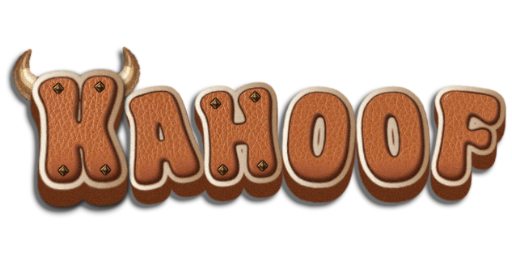

  
    
  <h1>Kahoof</h1>
  <b>By Dukul</b>

Live quizzes for World of Warcraft. A host runs a quiz for their party, raid or guild; everyone
with the addon answers timed multiple-choice questions, scores by correctness and speed, and
climbs the leaderboard between questions. No server and no website: everything runs through the
game's own addon messages.

For Retail and WoW Forever. Early development: not ready for use yet.

---

Kahoof is a free fan project by Dukul, made for fun and never for money. It is not affiliated with, endorsed by or sponsored by Blizzard Entertainment or Kahoot! ASA. World of Warcraft, Warcraft and Blizzard Entertainment are trademarks or registered trademarks of Blizzard Entertainment, Inc. Kahoot! is a trademark of Kahoot! ASA. All other trademarks belong to their owners.
